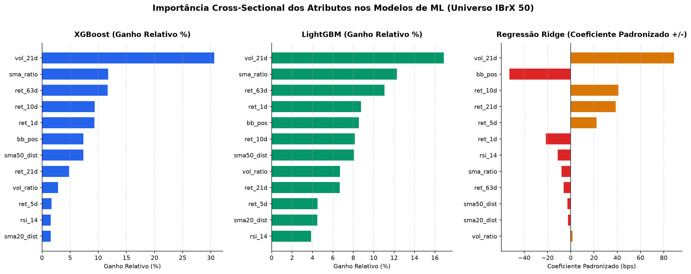
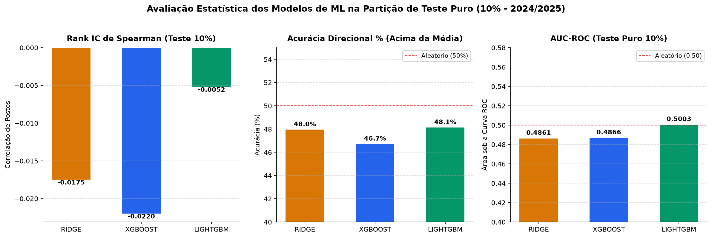
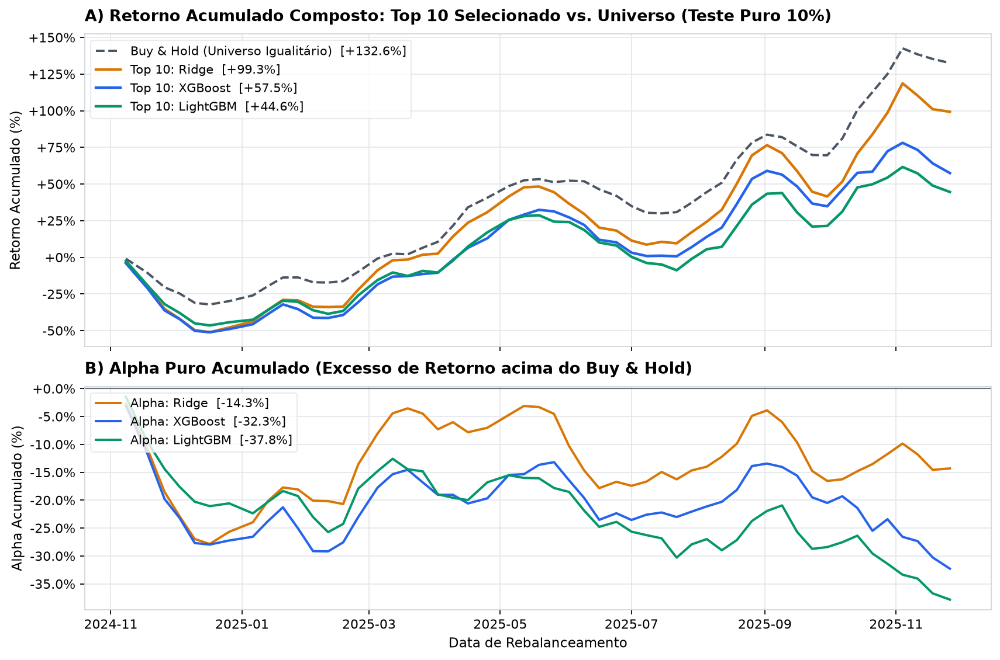

# Cross-Sectional Machine Learning para Seleção de Ações na B3 (IBrX 50)


Um pipeline quantitativo completo de **Ciência de Dados e Machine Learning** em Python para seleção *cross-sectional* de ações no mercado brasileiro (**B3 — Universo IBrX 50**, 2012–2025).

O foco central deste projeto é a integridade científica: engenharia de atributos estritamente causal (livre de *look-ahead bias*), divisão temporal cronológica com purga (*embargo*) para eliminar vazamento de rótulos futuros, otimização de hiperparâmetros na validação e confronto sistemático entre modelos lineares regularizados e algoritmos de *gradient boosting* (árvores *depth-wise* vs. *leaf-wise*).

---

## 🎯 Destaques Metodológicos

1. **Higienização de Dados Reais da B3 (`data_loader.py`):**
   * **Filtro de Feriados Espúrios:** Remoção de datas com menos de 20 ações ativas (feriados municipais ou dias sem pregão oficial da B3).
   * **Máscara de Pré-Listagem:** Ativos com volume zerado antes do início de sua liquidez real no IBrX 50 (ex.: `SUZB3` e `ENGI11`) são mascarados como `NaN`, impedindo falsos retornos de 0%.
   * **Ajuste Contínuo:** Preços de abertura e fechamento ajustados pelo fator acumulado de dividendos e desdobramentos.

2. **Engenharia de Atributos Causal ($\le t$) & Padronização Cross-Sectional (`features.py`):**
   * **12 Indicadores Técnicos:** Retornos defasados (1d, 5d, 10d, 21d, 63d), volatilidade realizada (21d), distâncias e razão de médias móveis (SMA 20/50), posição nas Bandas de Bollinger, RSI normalizado em $[-1, +1]$ e volume relativo.
   * **Z-Score Cross-Sectional:** Padronização relativa das ações a cada pregão ($Z = \frac{X - \mu_{dia}}{\sigma_{dia}}$), com corte rígido (*winsorize*) em $[-4, +4]$ para neutralizar o viés direcional diário da bolsa e isolar o *alpha* relativo.

3. **Divisão Temporal 70/20/10 com Purga / Embargo de 21 Dias (`splits.py`):**
   * Como o objetivo preditivo é o excesso de retorno nos **próximos 21 pregões úteis** ($t \to t+21$), uma divisão cronológica simples sofreria vazamento temporal nas fronteiras.
   * Aplicamos uma **purga matemática de 21 dias** no final do Treino e no final da Validação, garantindo isolamento total entre os conjuntos:
     * **Treino (70%):** Abr/2015 a Ago/2022 (13.265 amostras)
     * **Validação (20%):** Set/2022 a Out/2024 (4.063 amostras — seleção de hiperparâmetros)
     * **Teste Puro (10%):** Nov/2024 a Nov/2025 (2.171 amostras — avaliação estritamente *out-of-sample*)

4. **Comparação de Arquiteturas de ML (`models.py`):**
   * **Regressão Linear Ridge ($L_2$ Baseline):** Solução matricial fechada $(X^T X + \lambda I)^{-1} X^T y$ com seleção ótima do coeficiente de penalidade ($\lambda$).
   * **XGBoost:** *Gradient Boosted Trees* com divisão simétrica por nível (*depth-wise*).
   * **LightGBM:** *Gradient Boosted Trees* com divisão ótima por folha (*leaf-wise*).

---

## 📊 Resultados e Avaliação dos Modelos

### 1. Métricas de Machine Learning (Treino 70% / Validação 20% / Teste Puro 10%)

| Modelo | Partição | Amostras | RMSE | MAE | $R^2$ OOS (%) | IC Pearson | Rank IC (Spearman) | Acurácia Direcional (%) | AUC-ROC | F1-Score |
| :--- | :--- | :---: | :---: | :---: | :---: | :---: | :---: | :---: | :---: | :---: |
| **RIDGE** | 1. Treino (70%) | 13.265 | 0,0989 | 0,0693 | +1,09% | +0,1045 | +0,0582 | 52,83% | 0,5316 | 0,4657 |
| **RIDGE** | 2. Validação (20%) | 4.063 | 0,0799 | 0,0582 | -2,98% | -0,0574 | -0,0470 | 48,14% | 0,4820 | 0,4410 |
| **RIDGE** | **3. Teste Puro (10%)** | 2.171 | **0,0883** | **0,0634** | **-2,10%** | **-0,0348** | **-0,0175** | **47,95%** | **0,4861** | **0,4350** |
| **XGBOOST** | 1. Treino (70%) | 13.265 | 0,0980 | 0,0688 | +2,95% | +0,1908 | +0,1047 | 54,55% | 0,5547 | 0,4545 |
| **XGBOOST** | 2. Validação (20%) | 4.063 | 0,0798 | 0,0580 | -2,60% | -0,0138 | -0,0182 | 50,14% | 0,4973 | 0,4185 |
| **XGBOOST** | **3. Teste Puro (10%)** | 2.171 | **0,0886** | **0,0638** | **-2,77%** | **-0,0389** | **-0,0220** | **46,71%** | **0,4866** | **0,3783** |
| **LIGHTGBM**| 1. Treino (70%) | 13.265 | 0,0955 | 0,0674 | +7,71% | +0,3412 | +0,2166 | 57,69% | 0,6028 | 0,4901 |
| **LIGHTGBM**| 2. Validação (20%) | 4.063 | 0,0800 | 0,0582 | -3,28% | +0,0004 | -0,0099 | 49,94% | 0,4985 | 0,4162 |
| **LIGHTGBM**| **3. Teste Puro (10%)** | 2.171 | **0,0890** | **0,0639** | **-3,87%** | **-0,0267** | **-0,0052** | **48,13%** | **0,5003** | **0,3953** |

> **Diagnóstico Científico do Trade-off Viés-Variância:**
> - O **LightGBM** exibiu alta capacidade de memorização no treino ($R^2 = +7,71\%$ e Rank IC $= 0,2166$), mas sofreu perda expressiva de generalização no conjunto de teste estático devido à natureza de baixa razão sinal-ruído das séries financeiras.
> - A **Regressão Ridge**, com forte restrição estrutural de complexidade ($L_2$, $\lambda = 10$), evitou sobreajuste a ruídos pontuais e apresentou a menor degradação de erro ($RMSE = 0,0883$).

---

## 📈 Visualizações Geradas pelo Pipeline

### 1. Importância dos Atributos em Percentual de Ganho (Gain %) e Coeficientes


### 2. Comparativo de Métricas no Teste Puro Out-of-Sample (10%)


### 3. Retorno Acumulado Composto do Top 10 Selecionado vs. Buy & Hold


---

## 🏗️ Estrutura do Repositório

```text
quant-ml-b3-portfolio/
├── README.md                              # Documentação executiva e fundamentação teórica
├── pyproject.toml                         # Empacotamento moderno (PEP 621) e configuração do pytest
├── requirements.txt                       # Dependências reproduzíveis
├── data/
│   └── processed/                         # Cotações históricas da B3 tratadas (41 ações do IBrX 50)
├── src/
│   └── quant_ml_b3/
│       ├── data_loader.py                 # Leitura local e coletor do Yahoo Finance com filtro de liquidez
│       ├── features.py                    # 12 indicadores causais e Z-score cross-sectional
│       ├── splits.py                      # Divisão cronológica 70/20/10 com purga temporal (21 dias)
│       ├── models.py                      # Treinamento e tuning de Ridge, XGBoost e LightGBM
│       ├── metrics.py                     # Métricas de regressão, ranking (IC) e seleção Top-K
│       └── plotting.py                    # Gráficos em alta resolução
├── scripts/
│   ├── run_experiment.py                  # CLI principal para executar todo o pipeline de ML
│   └── fetch_yfinance.py                  # Utilitário opcional para download direto da API
├── notebooks/
│   └── 01_ml_quant_strategies_b3.ipynb    # Jupyter Notebook demonstrativo pré-executado
├── outputs/
│   ├── figures/                           # Gráficos exportados em PNG
│   └── tables/                            # Tabelas exportadas em CSV
└── tests/                                 # Suíte de testes unitários automatizados (pytest)
```

---

## 🚀 Como Reproduzir Localmente

### 1. Clonar e Instalar Dependências
```bash
git clone https://github.com/SEU-USUARIO/quant-ml-b3-portfolio.git
cd quant-ml-b3-portfolio
pip install -r requirements.txt
```

### 2. Rodar a Suíte de Testes Automatizados (`pytest`)
Valida a ausência de *look-ahead bias*, a normalização *cross-sectional* e a purga temporal:
```bash
pytest -v
```

### 3. Executar o Experimento Completo de Machine Learning
```bash
python scripts/run_experiment.py
```

---

## 👤 Autor

**Pedro Magalhães**  
Ciência da Computação · Ciência de Dados & Machine Learning
