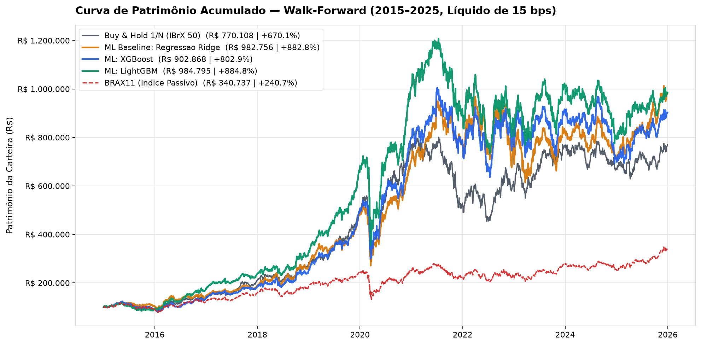
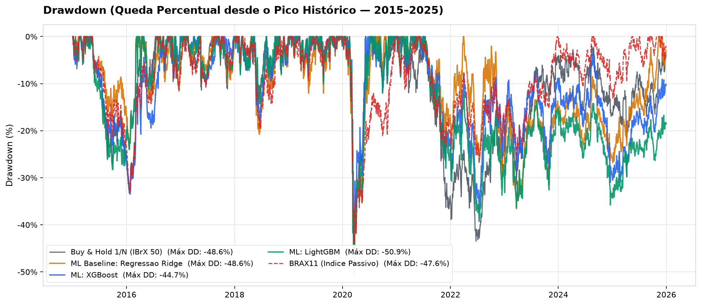
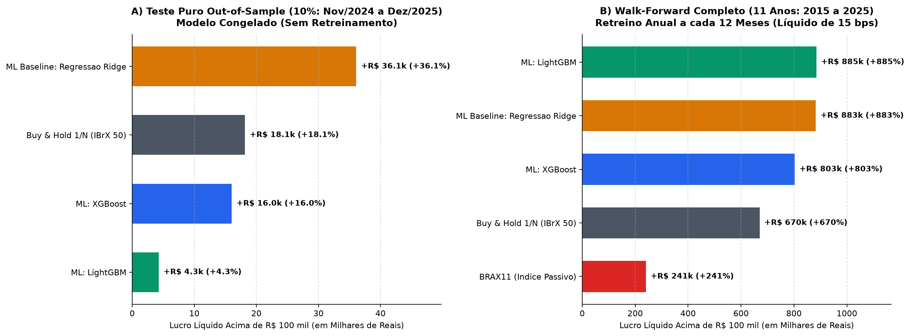

# Cross-Sectional Machine Learning & Event-Driven Backtesting on the B3 (IBrX 50)


Um pipeline completo de **Ciência de Dados e Finanças Quantitativas** em Python para seleção *cross-sectional* de ações no mercado brasileiro (**B3 — Universo IBrX 50**, 2012–2025), integrando engenharia de atributos livre de *look-ahead bias*, divisão temporal com purga (*embargo*), avaliação estatística de *ranking* e um motor próprio de *backtesting* orientado a eventos com custos operacionais reais (`15 bps`).

---

## Destaques do Projeto (Por que este repositório se destaca)

1. **Prevenção Estrita de *Look-Ahead Bias* e Vazamento Temporal:**
   - **Higienização do Universo B3:** Remoção de datas espúrias de feriados sem negociação na B3 e mascaramento de períodos pré-listagem (`volume == 0`) como `NaN`, evitando falsos retornos zero ou execuções irreais.
   - **Engenharia Causal de *Features* ($\le t$):** 12 indicadores técnicos e estatísticos calculados estritamente até o fechamento do dia $t$, padronizados por *Z-score cross-sectional* a cada pregão (winsorizados em $[-4, +4]$).
   - **Divisão Temporal 70/20/10 com Purga (*Embargo* de 21 Pregões):** Como o *target* preditivo mede o excesso de retorno nos **21 pregões seguintes** ($t \to t+21$), aplica-se uma zona de purga nas fronteiras `Treino -> Validação` e `Validação -> Teste` para garantir que nenhum rótulo futuro atravesse de uma partição para outra.

2. **Modelagem e Controle de *Turnover* (Banda de Histerese):**
   - Comparação sistemática entre **Regressão Linear Ridge ($L_2$ Baseline)**, **XGBoost** (*depth-wise boosting*) e **LightGBM** (*leaf-wise boosting*).
   - Seleção mensal das **Top 10** ações com maior retorno relativo previsto, combinada a uma **banda de manutenção (histerese Top 20)**: ativos já em carteira que permanecem entre os 20 melhores do *ranking* não são substituídos, reduzindo drasticamente o giro desnecessário e a erosão por custos.

3. **Motor de *Backtest* Orientado a Eventos Realista:**
   - Sinais gerados no fechamento de $t$ são executados exclusivamente na **abertura ajustada de $t+1$**.
   - Quantidades inteiras de ações (`floor`), venda antes da compra, proibição estrita de caixa negativo e dedução de **15 bps por operação** (`10 bps` corretagem + `5 bps` *slippage*).

---

## Principais Resultados (Capital Inicial: R$ 100.000,00 | Líquido de 15 bps)

| Estratégia / Benchmark | Teste Puro *Out-of-Sample* (10%: Nov/24–Dez/25, Modelo Congelado) | Walk-Forward Completo (2015–2025, Retreino Anual a cada 12m) |
| :--- | :--- | :--- |
| **ML: LightGBM (Top 10)** | `R$ 104.253` (`+4,25%` · `Win 65,1%`) | **`R$ 984.795`** (**`+884,80%`** · `23,55% a.a.` · `Sharpe 0,83` · `Win 67,7%`) |
| **ML Baseline: Regressão Ridge** | **`R$ 136.091`** (**`+36,09%`** · `Sharpe 1,66` · `Win 75,3%`) | **`R$ 982.756`** (**`+882,76%`** · `23,52% a.a.` · `Sharpe 0,86` · `Win 69,4%`) |
| **ML: XGBoost (Top 10)** | `R$ 116.019` (`+16,02%` · `Sharpe 0,67` · `Win 69,5%`) | **`R$ 902.868`** (**`+802,87%`** · `22,56% a.a.` · `Sharpe 0,80` · `Calmar 0,50`) |
| **Buy & Hold 1/N (IBrX 50)** | `R$ 118.139` (`+18,14%` · `Sharpe 0,86`) | `R$ 770.108` (`+670,11%` · `20,77% a.a.` · `Sharpe 0,75` · `Calmar 0,43`) |
| **BRAX11 (Índice Passivo ETF)** | — | `R$ 340.737` (`+240,74%` · `12,00% a.a.` · `Sharpe 0,51` · `Calmar 0,25`) |

> **Insight Quantitativo Central:**
> - No **Teste Puro *Out-of-Sample* (modelo congelado por 14 meses sem retreino)**, a forte regularização linear da **Regressão Ridge ($L_2$)** evita sobreajuste a regimes transitórios e entrega **`+36,09%` (`Sharpe 1,66`)**, quase o dobro do *Buy & Hold 1/N* (`+18,14%`).
> - No **Walk-Forward de 11 anos (2015–2025) com retreino anual**, os modelos não-lineares adaptam-se às rotações estruturais de ciclo econômico, permitindo que **LightGBM (`+884,80%`)**, **Ridge (`+882,76%`)** e **XGBoost (`+802,87%`)** superem com folga tanto a carteira passiva igualitária (`+670,11%`) quanto o ETF `BRAX11` (`+240,74%`).

---

## Visualizações Geradas pelo Pipeline

### 1. Curva de Patrimônio Acumulado em *Walk-Forward* (2015–2025)


### 2. *Drawdown* (Queda Percentual desde o Pico Histórico — 2015–2025)


### 3. Confronto Direto: Teste Puro *Out-of-Sample* (10%) vs. *Walk-Forward* (11 Anos)


### 4. Importância *Cross-Sectional* dos Atributos (XGBoost, LightGBM e Ridge)


---

## Engenharia de Atributos (*Features* Técnicas e Estatísticas)

Cada par $(\text{data } t, \text{ação } i)$ é descrito por **12 indicadores** calculados com janela estritamente causal ($\le t$) e padronizados via *Z-score* entre as ações ativas no dia $t$:

| Atributo | Categoria | Definição Matemática (em $t$) |
| :--- | :--- | :--- |
| `ret_1d`, `ret_5d`, `ret_10d`, `ret_21d`, `ret_63d` | Momentum / Reversão | Retornos acumulados em 1, 5, 10, 21 e 63 pregões: $P_t / P_{t-k} - 1$ |
| `vol_21d` | Risco / Volatilidade | Desvio-padrão amostral dos retornos diários nos últimos 21 pregões |
| `sma20_dist`, `sma50_dist` | Tendência | Distância relativa do fechamento para as médias móveis de 20 e 50 dias |
| `sma_ratio` | Cruzamento de Médias | Razão entre a média curta e longa: $\text{SMA}_{20}(t) / \text{SMA}_{50}(t) - 1$ |
| `rsi_14` | Oscilador | Índice de Força Relativa de 14 pregões reescalado para $[-1, +1]$ |
| `bb_pos` | Bandas de Bollinger | Posição normalizada do preço: $(P_t - \text{SMA}_{20}) / (2 \cdot \sigma_{20})$ |
| `vol_ratio` | Fluxo / Liquidez | Volume médio de 5 dias dividido pelo volume médio de 21 dias ($\text{clip } [-2, +5]$) |

---

## Estrutura do Repositório

```text
quant-ml-b3-portfolio/
├── README.md                              # Documentação executiva, metodologia e resultados
├── pyproject.toml                         # Configuração de pacote Python moderno e pytest
├── requirements.txt                       # Dependências reproduzíveis
├── data/
│   └── processed/                         # Base histórica higienizada do IBrX 50 (41 ações) e BRAX11
├── src/
│   └── quant_ml_b3/
│       ├── data_loader.py                 # Leitura local + atualização opcional via Yahoo Finance (yfinance)
│       ├── features.py                    # Engenharia das 12 features sem look-ahead bias + Z-score cross-sectional
│       ├── splits.py                      # Divisão cronológica 70/20/10 com purga (embargo de 21 pregões)
│       ├── metrics.py                     # Métricas de ML (IC, Rank IC, AUC, Spread Top 10) e finanças (Sharpe, Calmar)
│       ├── models.py                      # Treinamento e seleção de hiperparâmetros (Ridge, XGBoost, LightGBM)
│       ├── backtest.py                    # Motor event-driven (execução no open de t+1, custos de 15 bps, histerese)
│       └── plotting.py                    # Geração automatizada das figuras de alta resolução
├── scripts/
│   ├── run_experiment.py                  # Executa o experimento completo e salva tabelas e gráficos
│   └── fetch_yfinance.py                  # Utilitário opcional para atualizar cotações direto da API do Yahoo Finance
├── notebooks/
│   └── 01_ml_quant_strategies_b3.ipynb    # Notebook executivo pré-renderizado para inspeção rápida no GitHub
├── outputs/
│   ├── figures/                           # Gráficos PNG gerados pelo experimento
│   └── tables/                            # Tabelas CSV com métricas de ML e resultados de backtest
└── tests/                                 # Suíte de testes automatizados (pytest) validando invariantes causais e financeiros
```

---

## Como Executar Localmente

### 1. Clonar e instalar dependências
```bash
git clone https://github.com/SEU-USUARIO/quant-ml-b3-portfolio.git
cd quant-ml-b3-portfolio
pip install -r requirements.txt
```

### 2. Rodar a suíte de testes automatizados (`pytest`)
Verifica ausência de *look-ahead bias*, purga temporal, padronização *cross-sectional* e invariantes de caixa do simulador:
```bash
pytest -v
```

### 3. Reproduzir o experimento completo (Ciência de Dados + Backtest + Gráficos)
```bash
python scripts/run_experiment.py
```

### 4. (Opcional) Atualizar cotações da B3 via Yahoo Finance (`yfinance`)
```bash
python scripts/fetch_yfinance.py --start 2012-01-01 --end 2026-01-01
```

---

## Autor

**Pedro Magalhães**  
Ciência da Computação · Machine Learning & Finanças Quantitativas
